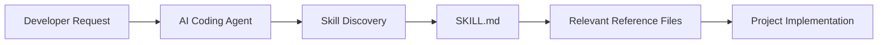

# Perci Skills

Reusable engineering standards for AI coding agents. This repository packages practical instructions, references, and examples so developers can give agents consistent project-aware guidance without adding a framework, service, or runtime dependency.

## 1. Project Overview

Perci Skills is a lightweight collection of skills for coding agents, with a focus on OpenAI Codex and Claude Code. A skill is a directory centered on a `SKILL.md` file. It describes when and how an agent should apply a repeatable workflow or engineering standard, with supporting references and examples loaded when relevant.

Skills guide an agent; they do not enforce standards or change application code on their own. The agent still needs to discover and use the skill, and developers remain responsible for reviewing its work.

## 2. Key Features

- Agent-neutral engineering guidance packaged in a familiar folder structure.
- Progressive disclosure: short entry-point instructions link to focused reference files.
- Project-level installation for standards that should travel with a codebase.
- User-level installation for personal defaults shared across projects.
- Laravel guidance that prioritizes native framework features and existing project conventions.
- No required installer, Docker setup, web server, or runtime dependency.

## 3. Available Skills

### Laravel Backend

Path: [`skills/laravel-backend/`](skills/laravel-backend/)

The Laravel Backend skill guides agents working on Laravel architecture, models, migrations, HTTP endpoints, authorization, security, background work, integrations, and tests. Its frontmatter identifies the skill as `laravel-backend` and describes when an agent should consider it.

Other technologies mentioned in examples below are not packaged skills. See [Planned Skills / Roadmap](#13-planned-skills--roadmap) for ideas that are not implemented yet.

## 4. Quick Start

From the root of a Laravel application, copy the skill into the discovery directory for your agent:

```bash
# Codex
mkdir -p .agents/skills
cp -R /path/to/perci-skills/skills/laravel-backend .agents/skills/laravel-backend

# Claude Code
mkdir -p .claude/skills
cp -R /path/to/perci-skills/skills/laravel-backend .claude/skills/laravel-backend
```

Replace `/path/to/perci-skills` with the checkout location. Then ask the agent: “Use the `laravel-backend` skill to review this API change.” See [Installation Guide](#5-installation-guide) for global, linked, and update options.

## 5. Installation Guide

### Supported locations

| Agent | Project-level (recommended) | User-level (all projects) |
| --- | --- | --- |
| Codex | `.agents/skills/` | `~/.agents/skills/` |
| Claude Code | `.claude/skills/` | `~/.claude/skills/` |

Each skill should be installed as its own directory, with `SKILL.md` directly inside it. These locations follow the agents' documented filesystem discovery conventions: [Codex skills](https://developers.openai.com/api/reference/cli) and [Claude Code skills](https://platform.claude.com/docs/en/agents-and-tools/agent-skills/overview).

### Install one skill for a project

Clone this repository once, then run the commands from the application root. Adjust the clone path if you keep it elsewhere.

```bash
git clone https://github.com/percivalarendain/perci-skills.git ~/perci-skills
cd /path/to/your-project

# Codex
mkdir -p .agents/skills
cp -R ~/perci-skills/skills/laravel-backend .agents/skills/laravel-backend

# Claude Code
mkdir -p .claude/skills
cp -R ~/perci-skills/skills/laravel-backend .claude/skills/laravel-backend
```

Replace `/path/to/your-project` with the path to your project. Choose the commands for the agent you use. Copy other available skill directories the same way; do not copy planned skills that do not exist.

These install commands assume the `laravel-backend` destination does not already exist. If it is already installed, use [Updating and Maintaining Skills](#7-updating-and-maintaining-skills) instead of repeating the initial copy command.

### Install for all your projects

User-level installation makes the skill available from any project opened by that user. It does not add the skill to the project repository.

```bash
# Codex
mkdir -p "$HOME/.agents/skills"
cp -R ~/perci-skills/skills/laravel-backend "$HOME/.agents/skills/laravel-backend"

# Claude Code
mkdir -p "$HOME/.claude/skills"
cp -R ~/perci-skills/skills/laravel-backend "$HOME/.claude/skills/laravel-backend"
```

As with project installs, the target skill directory should not already exist. Use the update instructions for an existing installation.

### Copy, link, or use an installer

- **Copy** creates an independent snapshot. It is suitable for project-level use and can be committed with the project. Updates must be copied again.
- **Symlink** points the agent's skill directory at this checkout. Changes in the checkout appear in the linked skill, which is useful when editing or maintaining the skill. The checkout must stay at that path.
- **Installer tooling** can place a skill into an agent's supported directory and select project or user scope. Perci Skills does not ship an installer. OpenAI documents the optional `gh skill install` command for Codex and Claude Code:

  ```bash
  # Project scope
  gh skill install percivalarendain/perci-skills laravel-backend --agent codex --scope project
  gh skill install percivalarendain/perci-skills laravel-backend --agent claude-code --scope project

  # User scope (all projects)
  gh skill install percivalarendain/perci-skills laravel-backend --agent codex --scope user
  gh skill install percivalarendain/perci-skills laravel-backend --agent claude-code --scope user
  ```

  This requires a GitHub CLI installation that provides `gh skill`; confirm the available options with `gh skill install --help` and the [current CLI instructions](https://developers.openai.com/api/reference/cli). Installer-managed copies follow that tool's update and removal workflow. This is optional and separate from the direct copy commands above.

Example symlink from an application root:

```bash
mkdir -p .agents/skills
ln -s ~/perci-skills/skills/laravel-backend .agents/skills/laravel-backend
```

Use `.claude/skills` instead for Claude Code. The destination must not already exist. If it does, inspect it before moving or removing anything.

### Verify discovery

Check the expected file exists at the selected location:

```bash
test -f .agents/skills/laravel-backend/SKILL.md && echo "Skill files are in place"
```

Use `.claude/skills` or the user-level path in that check when applicable. Then open or restart the agent session if needed and explicitly ask it to use `laravel-backend`. Confirm that it can identify the skill and read its entry point. Availability and discovery details depend on the agent and its configuration; a file on disk alone does not guarantee that every client will load it.

### Optional project instruction templates

[`templates/AGENTS.md`](templates/AGENTS.md) and [`templates/CLAUDE.md`](templates/CLAUDE.md) are optional starting points for project-level agent instructions. They tell agents when to consult the Laravel Backend skill and reinforce project-first practices. Review and merge the relevant guidance into your existing `AGENTS.md` or `CLAUDE.md`; do not overwrite project instructions blindly. These files complement skills and are not required to install one.

Docker is optional. This repository does not require Docker or include an application that needs to be run.

## 6. Usage Examples

Ask for the skill by name when you want to make its use explicit. The skill gives guidance; it does not automatically implement or enforce the request.

- **Create an API endpoint:** “Use the `laravel-backend` skill to add a paginated `GET /api/v1/departments` endpoint. Inspect the Laravel version and existing route, resource, and test conventions first.”
- **Add a secure payment operation:** “Use the `laravel-backend` skill to add a payment capture flow. Review authorization, transaction boundaries, provider idempotency, webhook verification, and rate limiting before changing code.”
- **Implement a migration:** “Use the `laravel-backend` skill to add a nullable indexed `department_id` with a foreign key. Follow existing naming conventions and check rollback behavior.”
- **Apply rate limiting:** “Use the `laravel-backend` skill to rate-limit the public search endpoint. Use Laravel's native limiter, a configurable policy, and tests for enforcement and reset behavior.”
- **Write automated tests:** “Use the `laravel-backend` skill to add focused feature tests for this endpoint, including validation, authorization, and successful behavior.”
- **Review existing code:** “Use the `laravel-backend` skill to review this Laravel change for regressions in validation, authorization, data integrity, security, and tests. Report findings before editing.”

The agent may select relevant references from the skill, or you can name one directly, such as “also read the rate-limiting reference.”

## 7. Updating and Maintaining Skills

To update a copied skill, fetch or pull the repository checkout and copy the updated directory over the installed one. For example, from your project root:

```bash
cp -R ~/perci-skills/skills/laravel-backend/. .agents/skills/laravel-backend/
```

Use `.claude/skills/laravel-backend/` for Claude Code. This overwrites files with matching names and adds new files, but leaves extra files that exist only in the installed copy. Back up local edits first. If you want an exact clean copy, inspect and back up the target, remove only that skill directory, and copy it again. Never remove the parent `.agents/skills` or `.claude/skills` directory as part of removing one skill.

For symlink installations, update the repository checkout; the linked skill uses those files directly. For an installer-managed copy, follow that tool's update workflow. Review changes to `SKILL.md`, references, and examples before distributing updates to a team.

To remove a copied project-level skill, first confirm the path, then remove only the skill directory:

```bash
rm -r .agents/skills/laravel-backend
```

For a symlink, remove the link itself with `rm .agents/skills/laravel-backend`. Use the equivalent `.claude/skills/laravel-backend` or user-level path as needed. Check whether the directory contains local work before removing a copied installation. Removing a skill never requires deleting the shared parent skills directory.

## 8. Architecture Overview

The diagram shows the intended workflow. Actual discovery and loading depend on the agent, its configuration, and whether the skill is in a supported location.



- **`SKILL.md`** is the small entry point. Its frontmatter gives the skill a name and a description for discovery; its body explains scope, workflow, and which references to read.
- **Reference files** hold focused standards and details that apply to particular tasks.
- **Examples** show one concrete implementation shape. They are starting points, not templates to apply mechanically.
- **Agent-specific configuration** connects an agent to a skill or provides project-level instructions. Codex and Claude Code use their own discovery locations; `AGENTS.md` and `CLAUDE.md` templates are optional complements.
- **Project conventions take precedence where appropriate.** The Laravel skill asks the agent to inspect the installed Laravel version, packages, tests, and existing patterns before implementing changes.
- **Progressive disclosure** means the agent can read only references relevant to the request, reducing irrelevant context while keeping the entry point concise.
- **Reusable standards** focus on Laravel behavior and engineering principles rather than one application's namespaces, tables, routes, or business rules.

For example, a Laravel API endpoint that creates a payment might call for architecture and controller guidance, FormRequest validation, Policy authorization, the rate-limiting security standard, and testing guidance. The agent selects those references for the requested change, then adapts them to the application's actual Laravel version, payment provider, and conventions.

## 9. How Skills Work

An agent discovers the skill directory, reads its `SKILL.md` metadata, and decides whether the skill applies to a request. If useful, it reads linked reference files or examples, then applies that guidance while inspecting and changing the project. The decision to use a skill and the amount of supporting material loaded vary by agent.

Skills are instructions and documentation, not executable policy engines. They do not automatically change code, run tests, grant tool access, or guarantee compliance. Give clear requests, provide the agent's expected project access, and review generated changes.

## 10. Engineering Standards

The [Laravel Backend skill](skills/laravel-backend/SKILL.md) organizes its guidance by responsibility. Read the linked reference files for task-specific detail.

| Responsibility | What the standard guides the agent to do | References |
| --- | --- | --- |
| Application Architecture | Inspect the application first, keep controllers thin, and use a small route-to-controller/request/policy/action/model flow where appropriate. | [Architecture](skills/laravel-backend/references/architecture.md), [controllers and requests](skills/laravel-backend/references/controllers-requests.md) |
| Request Validation | Validate non-trivial input in FormRequests, authorize at the request boundary where appropriate, and use validated fields. | [Controllers and requests](skills/laravel-backend/references/controllers-requests.md) |
| Authorization | Use Policies for resource access and test allowed, denied, ownership, and tenant boundaries. | [Authorization](skills/laravel-backend/references/authorization.md) |
| Actions and Services | Give Actions a clear use-case responsibility and Services reusable capabilities; avoid wrapper classes and speculative layers. | [Actions](skills/laravel-backend/references/actions.md), [Services](skills/laravel-backend/references/services.md) |
| Database and Transactions | Keep the database authoritative, use constraints for integrity, and transact related writes that must succeed or fail together. | [Database](skills/laravel-backend/references/database.md), [migrations](skills/laravel-backend/references/migrations.md) |
| API Design | Use stable resources, clear status codes, pagination, allowlisted filters, and versioning consistent with the application. | [API](skills/laravel-backend/references/api.md) |
| Security and Rate Limiting | Use Laravel's native throttle middleware and `RateLimiter`, configurable route-specific limits, shared Redis-backed limits for multi-server deployments when appropriate, consistent HTTP 429 responses with `Retry-After`, and tests. Abuse prevention is separate from payment idempotency; verify webhook signatures and use provider-aware capacity limits instead of blindly throttling legitimate webhooks. | [Rate limiting](skills/laravel-backend/references/rate-limiting.md), [authorization](skills/laravel-backend/references/authorization.md) |
| Jobs and Queues | Queue slow or independently retryable work when useful, define retry behavior, and make job effects safe to repeat. | [Jobs and queues](skills/laravel-backend/references/jobs-queues.md) |
| Caching | Add caching only when it provides measurable value; use Laravel Cache and keep the database as the source of truth. | [Caching](skills/laravel-backend/references/caching.md) |
| Logging and Monitoring | Record useful operational and security context without leaking secrets or logging every routine success. | [Logging](skills/laravel-backend/references/logging.md), [exceptions](skills/laravel-backend/references/exceptions.md) |
| Testing | Add deterministic tests for public behavior and durable state, using the project's test framework and installed Laravel version. | [Testing](skills/laravel-backend/references/testing.md) |

## 11. Repository Structure

```text
perci-skills/
├── skills/
│   └── laravel-backend/
│       ├── SKILL.md
│       ├── references/
│       └── examples/
├── templates/
│   ├── AGENTS.md
│   └── CLAUDE.md
├── LICENSE
└── README.md
```

The references and examples are part of the Laravel skill folder. Copy or link that complete folder so its relative links continue to work.

## 12. Design Principles

- Prefer framework-native solutions before custom abstractions.
- Inspect the target project before introducing conventions.
- Follow established project conventions unless intentionally changing them.
- Use the smallest maintainable design that meets the requirement.
- Load detailed references only when relevant.
- Keep shared guidance agent-neutral where possible.
- Keep Docker and other infrastructure optional.

## 13. Planned Skills / Roadmap

These ideas are not currently implemented and are not available for installation:

- Inertia.js
- React
- Vue
- Tailwind CSS
- Pest-specific guidance
- Filament
- Docker and development tooling

They may become separate skills later. The current available skill list is limited to the directories present under [`skills/`](skills/).

## 14. Contributing

Contributions should keep guidance concise, reusable, and grounded in supported tools and framework behavior.

1. Update the relevant skill entry point, reference, or example rather than duplicating guidance in the README.
2. Keep `SKILL.md` metadata clear about what the skill does and when it applies.
3. Use relative links for files inside the repository and verify each target exists.
4. Mark proposals as planned until their skill directory and documentation exist.
5. Avoid application-specific rules, required infrastructure, and unrelated dependencies.

## 15. License

Perci Skills is distributed under the [MIT License](LICENSE).
